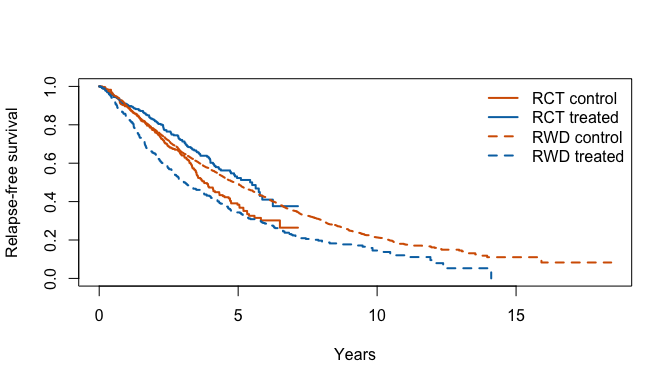
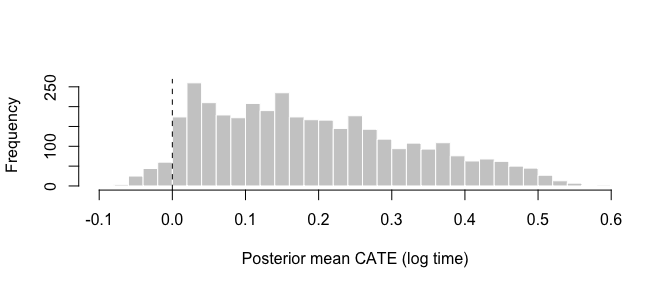
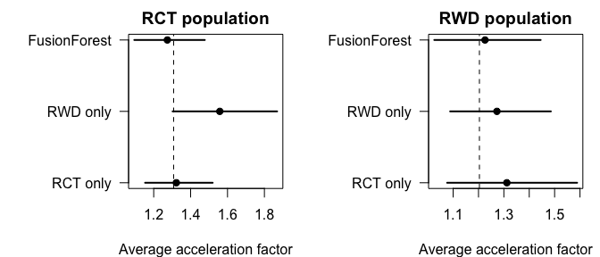
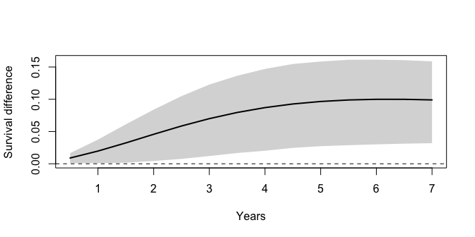
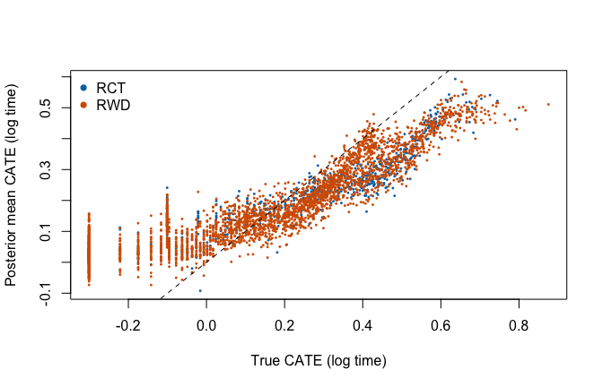
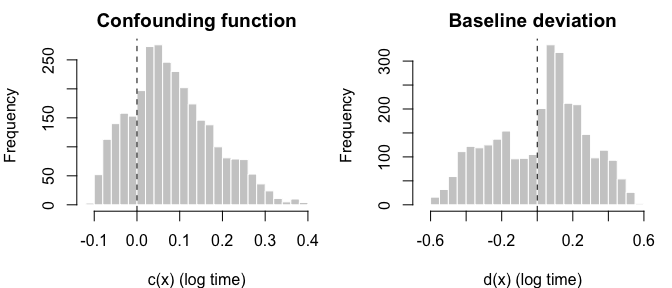

<!--
This vignette is precomputed.
Do not edit FusionForests.Rmd.
Edit FusionForests.Rmd.orig.
Then run vignettes/precompile.R.
-->


## Introduction

We introduce the **FusionForests** package.
It estimates heterogeneous treatment effects on survival from a randomised controlled trial (RCT) and real-world data (RWD) from an observational study.
An RCT alone rarely suffices, because RCTs are often small.
RWD are often more abundant but may suffer from unmeasured confounding.
This confounding biases the estimated treatment effects.
**FusionForests** combines both sources.
The RCT protects the estimates against confounding, and the RWD contribute a larger sample.
Jacobs, van der Pas and van Wieringen (2026) develop the methodology.

For a patient with covariates $x$, treatment $A$ and source $S$ (1 = RCT, 0 = RWD), the log survival time follows an accelerated failure time model:
$$
\log T = m_0^{\mathrm{sh}}(x) + (1 - S)\, d(x) + A\, \tau(x) + (1 - S)\, A\, c(x) + \varepsilon .
$$
The error $\varepsilon$ has mean zero.
It follows a hierarchical Dirichlet process mixture with a scale per source.
Each of the four functions receives its own Bayesian additive regression tree (BART) prior (Chipman et al., 2010).
The four functions are contrasts of the conditional mean log survival time.
We write this mean as follows:
$$
\mu(x, a, s) = \mathrm{E}[\log T \mid X = x, A = a, S = s].
$$
The shared baseline is the mean log survival time of untreated RCT patients:
$$
m_0^{\mathrm{sh}}(x) = \mu(x, 0, 1).
$$
The deviation is the difference between the RWD and RCT baselines:
$$
d(x) = \mu(x, 0, 0) - \mu(x, 0, 1).
$$
The conditional average treatment effect (CATE) is the causal effect on the log survival time:
$$
\tau(x) = \mathrm{E}[\log T(1) - \log T(0) \mid X = x] = \mu(x, 1, 1) - \mu(x, 0, 1),
$$
where $T(a)$ is the survival time under treatment $a$.
The CATE is common to both sources.
The confounding function is the bias of the treatment contrast in the RWD:
$$
c(x) = \mu(x, 1, 0) - \mu(x, 0, 0) - \tau(x).
$$
Jacobs, van der Pas and van Wieringen (2026) show that this decomposition holds and that $\tau$ and $c$ are identified.
Their result requires standard assumptions on the causal structure and the censoring mechanism, randomisation in the RCT and transportability of the CATE across sources.
The paper states these assumptions in full.

We illustrate the package on a semi-synthetic data set.
We describe the data, fit the model and summarise the posterior of the treatment effect, the confounding function and the error model.
The outcomes are simulated, so we can compare every estimate with the truth.

## Data

The data set `breast_fusion` combines an RCT of 686 patients with RWD on 2,982 patients.
The covariates are derived from the GBSG2 trial (Schumacher et al., 1994) and the Rotterdam tumour bank (Royston and Altman, 2013).
The datasets are distributed with the **survival** package.
The relapse-free survival times are simulated, and the RCT treatment is randomised.
The RWD treatment is the real, non-random treatment assignment of the Rotterdam cohort.
This assignment depends in part on year of surgery and chemotherapy, which `breast_fusion` omits.
The RWD are subject to unmeasured confounding.
The companion data set `breast_fusion_truth` contains the true CATE and the omitted confounders.
The data describe no real treatment or real clinical effect.


``` r
library(FusionForests)
#> 
#> Attaching package: 'FusionForests'
#> The following objects are masked _by_ '.GlobalEnv':
#> 
#>     breast_fusion, breast_fusion_truth
library(survival)

x_names <- c("age", "meno", "size", "grade", "nodes", "pgr", "er")
head(breast_fusion)
#>   id source S A      time status age meno size grade nodes pgr er
#> 1  1    RCT 1 0 5.4318960      0  49    0    0     0     2   0  0
#> 2  2    RCT 1 0 1.4229003      1  55    1    0     1    16   0  0
#> 3  3    RCT 1 1 2.4312115      0  56    1    1     1     3   0  0
#> 4  4    RCT 1 1 0.2083447      1  45    0    1     1     1   0  4
#> 5  5    RCT 1 0 2.0120523      1  65    1    1     0     5   0 36
#> 6  6    RCT 1 1 0.7031060      1  48    0    2     0    11   0  0
table(source = breast_fusion$source, treated = breast_fusion$A)
#>       treated
#> source    0    1
#>    RCT  353  333
#>    RWD 2643  339
```

The distribution of the covariates differs between the sources.
The RCT enrolled node-positive patients only, whereas the RWD also include node-negative patients.


``` r
round(sapply(split(breast_fusion[, x_names], breast_fusion$source),
             colMeans), 2)
#>          RCT    RWD
#> age    53.05  55.06
#> meno    0.58   0.56
#> size    0.81   0.64
#> grade   0.23   0.73
#> nodes   5.01   2.71
#> pgr   110.00 161.83
#> er     96.25 166.59
```

Figure 1 shows the Kaplan--Meier curves by source and arm.
The RCT follows patients for a shorter period than the RWD.


``` r
km   <- survfit(Surv(time, status) ~ source + A, data = breast_fusion)
cols <- rep(c("#D55E00", "#0072B2"), 2)
plot(km, col = cols, lty = c(1, 1, 2, 2), lwd = 2,
     xlab = "Years", ylab = "Relapse-free survival")
legend("topright", c("RCT control", "RCT treated", "RWD control", "RWD treated"),
       col = cols, lty = c(1, 1, 2, 2), lwd = 2, bty = "n")
```



## Fitting the model

`FusionForest()` takes covariate matrices, treatment and source indicators and the outcome.
We supply log survival times with their event indicators.
The test set determines where the posterior is evaluated.
We pass all patients as the test set, so that we can later summarise either source.
The argument `store_posterior_sample = TRUE` keeps the posterior draws that the summary functions need.
We run 5,000 burn-in and 5,000 posterior iterations, the package default.


``` r
X      <- as.matrix(breast_fusion[, x_names])
A      <- breast_fusion$A
S      <- breast_fusion$S
y      <- log(breast_fusion$time)
status <- breast_fusion$status
is_rct <- S == 1
is_os  <- S == 0

set.seed(42)
fit <- FusionForest(
  y = y, status = status,
  X_train_control = X, X_train_treat = X,
  treatment_indicator_train = A, source_indicator_train = S,
  X_test_control = X, X_test_treat = X,
  treatment_indicator_test = A, source_indicator_test = S,
  outcome_type = "right-censored", timescale = "log",
  N_post = 5000, N_burn = 5000,
  store_posterior_sample = TRUE, verbose = FALSE
)
#> Warning in FusionForest(y = y, status = status, X_train_control = X, X_train_treat = X, : internal error 1 in
#> R_decompress1 with libdeflate
#> Error in `FusionForest()`:
#> ! lazy-load database '/Library/Frameworks/R.framework/Versions/4.5-arm64/Resources/library/FusionForests/R/FusionForests.rdb' is corrupt
fit
#> Warning in get(method, envir = home): internal error 1 in R_decompress1 with libdeflate
#> Error in `get()`:
#> ! lazy-load database '/Library/Frameworks/R.framework/Versions/4.5-arm64/Resources/library/FusionForests/R/FusionForests.rdb' is corrupt
```

The default error model follows the paper.
It is the hierarchical Dirichlet process mixture with source-specific scales (`error_dist = "source_hdp_scale"`).
The summary reports the residual scale, the spread of the individual CATEs and the acceptance ratios of the tree updates.


``` r
summary(fit)
#>                                    Length  Class  Mode     
#> sigma                                 2000 -none- numeric  
#> train_predictions                     3668 -none- numeric  
#> test_predictions                      3668 -none- numeric  
#> train_predictions_control             3668 -none- numeric  
#> test_predictions_control              3668 -none- numeric  
#> train_predictions_treat               3668 -none- numeric  
#> test_predictions_treat                3668 -none- numeric  
#> train_predictions_deconf              2982 -none- numeric  
#> test_predictions_deconf               3668 -none- numeric  
#> train_predictions_deviation           2982 -none- numeric  
#> test_predictions_deviation            3668 -none- numeric  
#> acceptance_ratio_control                 1 -none- numeric  
#> acceptance_ratio_treat                   1 -none- numeric  
#> acceptance_ratio_deconf                  1 -none- numeric  
#> acceptance_ratio_deviation               1 -none- numeric  
#> train_predictions_sample_control   7336000 -none- numeric  
#> test_predictions_sample_control    7336000 -none- numeric  
#> train_predictions_sample_treat     7336000 -none- numeric  
#> test_predictions_sample_treat      7336000 -none- numeric  
#> train_predictions_sample_deconf    5964000 -none- numeric  
#> test_predictions_sample_deconf     7336000 -none- numeric  
#> train_predictions_sample_deviation 5964000 -none- numeric  
#> test_predictions_sample_deviation  7336000 -none- numeric  
#> dp_mode                                  1 -none- numeric  
#> dp_K                                     1 -none- numeric  
#> dp_num_groups                            1 -none- numeric  
#> dp_mix_prop                              2 -none- list     
#> dp_locations                             2 -none- list     
#> dp_mass                                  2 -none- list     
#> dp_sigma_g                               2 -none- list     
#> dp_locations_shared                 100000 -none- numeric  
#> dp_beta                             100000 -none- numeric  
#> dp_gamma                              2000 -none- numeric  
#> dp_mu_g                                  2 -none- list     
#> error_dist                               1 -none- character
#> meta                                    14 -none- list
```

### Treatment coding

The argument `treatment_coding` sets how the treatment indicator enters the model.
A coded treatment $b$ replaces $A$ in front of $\tau$ and $c$:
$$
\log T = m_0^{\mathrm{sh}}(x) + (1 - S)\, d(x) + b\, \{\tau(x) + (1 - S)\, c(x)\} + \varepsilon .
$$
The package offers three codings.

| `treatment_coding` | $b$ | $m_0^{\mathrm{sh}}$ and $d$ describe |
|:---|:---|:---|
| `"binary"` | $A$ | the untreated arm, as in the paper |
| `"centered"` (default) | $A - 1/2$ | the average of the two arms |
| `"adaptive"` | $A - \pi(x)$ | the average of the two arms, weighted by the propensity score $\pi(x)$ |

The functions $\tau$ and $c$ keep their meaning under every coding.
Under the binary coding, only treated patients inform $\tau$.
Under the centred coding, both arms inform $\tau$.
For this reason the centred coding is the default.
The adaptive coding follows Hahn et al. (2020).
It requires estimated propensity scores through `propensity_train` and `propensity_test`.
`fusion_estimand()` accounts for the coding of the fit, so the estimands below have the same meaning under every coding.

### Single-source comparators

We compare the fusion fit with two single-source analyses.
`ShrinkageTrees::CausalShrinkageForest()`, from the **ShrinkageTrees** package, fits a causal forest to one source.
We match its priors to those of `FusionForest()`.
The RCT-only fit is unbiased but may have a large posterior variance.
The RWD-only fit includes more patients, which lowers its posterior variance.
Its treatment effects are biased by the unmeasured confounders.


``` r
fit_single <- function(rows) {
  ShrinkageTrees::CausalShrinkageForest(
    y = y[rows], status = status[rows],
    X_train_control = X[rows, ], X_train_treat = X[rows, ],
    treatment_indicator_train = A[rows],
    X_test_control = X, X_test_treat = X, treatment_indicator_test = A,
    outcome_type = "right-censored", timescale = "log",
    number_of_trees_control = 200, number_of_trees_treat = 100,
    prior_type_control = "standard", prior_type_treat = "standard",
    local_hp_control = 1 / (2 * sqrt(200)),
    local_hp_treat = 0.5 / (2 * sqrt(100)),
    power_control = 2, power_treat = 3,
    N_post = 5000, N_burn = 5000,
    store_posterior_sample = TRUE, verbose = FALSE
  )
}
set.seed(42)
fit_rct <- fit_single(is_rct)
fit_os  <- fit_single(is_os)
```

## Treatment effects

### Acceleration factor

The acceleration factor $\exp\{\tau(x)\}$ multiplies the survival time of a patient with covariates $x$ under treatment.
`fusion_estimand()` returns its posterior draws at each test row.
With `population_average = TRUE` it averages over the test rows.
The average uses Bayesian-bootstrap weights (Rubin, 1981), which propagate uncertainty about the covariate distribution.
Our test set contains all patients of both sources.


``` r
af_union <- fusion_estimand(fit, "AF", population_average = TRUE, seed = 42)
#> Warning: restarting interrupted promise evaluation
#> Warning: internal error 1 in R_decompress1 with libdeflate
#> Error:
#> ! lazy-load database '/Library/Frameworks/R.framework/Versions/4.5-arm64/Resources/library/FusionForests/R/FusionForests.rdb' is corrupt
quantile(af_union, c(0.025, 0.5, 0.975))
#>     2.5%      50%    97.5% 
#> 1.046517 1.227491 1.439904
```

Figure 2 shows the distribution of the posterior mean CATE over the patients, on the log-time scale.


``` r
hist(fit$test_predictions_treat, breaks = 40, col = "grey80",
     border = "white", main = "", xlab = "Posterior mean CATE (log time)")
abline(v = 0, lty = 2)
```



We target a single source by averaging the draws over the test rows of that source.
We do so for the fusion fit and both comparators.


``` r
af_draws <- list(
  "RCT only"     = exp(fit_rct$test_predictions_sample_treat),
  "RWD only"     = exp(fit_os$test_predictions_sample_treat),
  "FusionForest" = fusion_estimand(fit, "AF")
)
#> Warning: restarting interrupted promise evaluation
#> Warning: internal error 1 in R_decompress1 with libdeflate
#> Error:
#> ! lazy-load database '/Library/Frameworks/R.framework/Versions/4.5-arm64/Resources/library/FusionForests/R/FusionForests.rdb' is corrupt
summarise_af <- function(rows) {
  t(sapply(af_draws, function(d) {
    v <- rowMeans(d[, rows])
    c(mean = mean(v), quantile(v, c(0.025, 0.975)))
  }))
}
af_tab  <- list(RCT = summarise_af(is_rct), RWD = summarise_af(is_os))
af_true <- c(RCT = mean(exp(breast_fusion_truth$tau[is_rct])),
             RWD = mean(exp(breast_fusion_truth$tau[is_os])))
lapply(af_tab, round, 3)
#> $RCT
#>               mean  2.5% 97.5%
#> RCT only     1.323 1.153 1.520
#> RWD only     1.558 1.302 1.869
#> FusionForest 1.274 1.095 1.477
#> 
#> $RWD
#>               mean  2.5% 97.5%
#> RCT only     1.312 1.076 1.589
#> RWD only     1.273 1.088 1.485
#> FusionForest 1.226 1.026 1.445
round(af_true, 3)
#>   RCT   RWD 
#> 1.308 1.204
```


``` r
op <- par(mfrow = c(1, 2), mar = c(4, 7.5, 2, 1))
for (p in names(af_tab)) {
  tb <- af_tab[[p]]
  plot(tb[, "mean"], 1:3, xlim = range(tb, af_true), yaxt = "n", pch = 19,
       xlab = "Average acceleration factor", ylab = "",
       main = paste(p, "population"))
  segments(tb[, "2.5%"], 1:3, tb[, "97.5%"], 1:3, lwd = 2)
  axis(2, at = 1:3, labels = rownames(tb), las = 1)
  abline(v = af_true[p], lty = 2)
}
```



``` r
par(op)
```


Figure 3 compares the three analyses.
In the RWD population, the interval of the fusion fit is 0.82 times as wide as the RCT-only interval.

Table 1 evaluates the individual CATEs on the log-time scale.
Bias and root mean squared error (RMSE) compare the posterior mean with the true CATE.
The posterior variance is averaged over patients.
Coverage is the proportion of patients whose 95% credible interval contains the true CATE.


``` r
tau_draws <- lapply(af_draws, log)
tau_true  <- breast_fusion_truth$tau

cate_metrics <- function(d, rows) {
  d   <- d[, rows]
  est <- colMeans(d)
  lo  <- apply(d, 2, quantile, 0.025)
  hi  <- apply(d, 2, quantile, 0.975)
  err <- est - tau_true[rows]
  c(bias     = mean(err),
    rmse     = sqrt(mean(err^2)),
    post_var = mean(apply(d, 2, var)),
    coverage = mean(lo <= tau_true[rows] & tau_true[rows] <= hi))
}

populations <- list(RCT = is_rct, RWD = is_os)
cate_tab <- do.call(rbind, lapply(names(populations), function(p)
  data.frame(population = p, analysis = names(tau_draws),
             t(sapply(tau_draws, cate_metrics, rows = populations[[p]])),
             row.names = NULL)))

knitr::kable(cate_tab, digits = 3,
             col.names = c("Population", "Analysis", "Bias", "RMSE",
                           "Posterior variance", "Coverage"),
             caption = "Table 1: Accuracy of the individual CATE estimates.")
```


Table: Table 1: Accuracy of the individual CATE estimates.

|Population |Analysis     |   Bias|  RMSE| Posterior variance| Coverage|
|:----------|:------------|------:|-----:|------------------:|--------:|
|RCT        |RCT only     |  0.007| 0.147|              0.028|    0.964|
|RCT        |RWD only     |  0.161| 0.239|              0.030|    0.815|
|RCT        |FusionForest | -0.012| 0.156|              0.019|    0.904|
|RWD        |RCT only     |  0.081| 0.166|              0.035|    0.949|
|RWD        |RWD only     |  0.037| 0.229|              0.034|    0.850|
|RWD        |FusionForest |  0.037| 0.175|              0.023|    0.840|


### Survival difference

The survival difference $S_1(t \mid x) - S_0(t \mid x)$ compares the survival probabilities at time $t$ under treatment and control.
It depends on the baseline and the error distribution as well as on $\tau$.
`fusion_estimand()` evaluates it in closed form at a time `time`, measured on the original time scale.
The argument `target_source` selects the baseline and error distribution of the RCT or the RWD.
We compute the difference in the RCT population over the first seven years (Figure 4).


``` r
times  <- seq(0.5, 7, by = 0.5)
sd_rct <- sapply(times, function(t) {
  d <- fusion_estimand(fit, "SD", time = t, target_source = "rct")
  v <- rowMeans(d[, is_rct])
  c(mean = mean(v), quantile(v, c(0.025, 0.975)))
})
#> Warning in FUN(X[[i]], ...): restarting interrupted promise evaluation
#> Warning in FUN(X[[i]], ...): internal error 1 in R_decompress1 with libdeflate
#> Error in `FUN()`:
#> ! lazy-load database '/Library/Frameworks/R.framework/Versions/4.5-arm64/Resources/library/FusionForests/R/FusionForests.rdb' is corrupt
round(sd_rct[, times == 5], 3)
#>  mean  2.5% 97.5% 
#> 0.097 0.027 0.159
```


``` r
plot(times, sd_rct["mean", ], type = "n", ylim = range(0, sd_rct),
     xlab = "Years", ylab = "Survival difference")
polygon(c(times, rev(times)), c(sd_rct["2.5%", ], rev(sd_rct["97.5%", ])),
        col = "grey85", border = NA)
lines(times, sd_rct["mean", ], lwd = 2)
abline(h = 0, lty = 2)
```



### Heterogeneity

The posterior mean CATE differs between patients.
Figure 5 plots it against the true CATE.
Tree ensembles shrink extreme effects towards the average, which flattens the point cloud.


``` r
tau_hat <- fit$test_predictions_treat
plot(breast_fusion_truth$tau, tau_hat, pch = 16, cex = 0.4,
     col = ifelse(is_rct, "#0072B2", "#D55E00"),
     xlab = "True CATE (log time)", ylab = "Posterior mean CATE (log time)")
abline(0, 1, lty = 2)
legend("topleft", c("RCT", "RWD"), col = c("#0072B2", "#D55E00"),
       pch = 16, bty = "n")
```



A linear summary of the CATE is easier to report than a nonparametric surface.
`fusion_projection()` projects every posterior draw of $\tau$ onto a linear basis (Woody et al., 2021).
The projection coefficients inherit a posterior distribution.
Bayesian-bootstrap weights add the uncertainty about the covariate distribution.
The basis columns are centred, so the intercept is the average CATE.
For reference, we project the true CATE onto the same basis.
In the simulation the CATE depends on the progesterone receptor and grade only.


``` r
basis <- ~ age + meno + size + grade + log1p(nodes) + log1p(pgr) + log1p(er)
proj  <- fusion_projection(fit, basis = basis, X_eval = as.data.frame(X),
                           weights = "bayesian_bootstrap", seed = 42)
#> Warning: restarting interrupted promise evaluation
#> Warning: internal error 1 in R_decompress1 with libdeflate
#> Error:
#> ! lazy-load database '/Library/Frameworks/R.framework/Versions/4.5-arm64/Resources/library/FusionForests/R/FusionForests.rdb' is corrupt

truth_df  <- cbind(as.data.frame(X), tau = breast_fusion_truth$tau)
proj_true <- coef(lm(update(basis, tau ~ .), data = truth_df))
proj_true[1] <- mean(breast_fusion_truth$tau)

proj_tab <- t(apply(proj, 2, function(v)
  c(mean = mean(v), quantile(v, c(0.025, 0.975)))))
round(cbind(proj_tab, truth = proj_true), 3)
#>                mean   2.5% 97.5%  truth
#> (Intercept)   0.190  0.027 0.351  0.162
#> age          -0.001 -0.007 0.004  0.000
#> meno          0.000 -0.191 0.192  0.000
#> size          0.028 -0.076 0.132  0.000
#> grade        -0.107 -0.285 0.067 -0.200
#> log1p(nodes) -0.006 -0.061 0.052  0.000
#> log1p(pgr)    0.043  0.007 0.080  0.115
#> log1p(er)     0.012 -0.021 0.046  0.000
```

## Confounding and baseline deviation

The forests for $c$ and $d$ describe how the RWD differ from the RCT.
A non-zero $c(x)$ signals that the treatment contrast in the RWD is biased at $x$.
A non-zero $d(x)$ signals that the RWD baseline differs from the RCT baseline.
Figure 6 shows the posterior means for the RWD patients.


``` r
c_hat <- fit$test_predictions_deconf[is_os]
d_hat <- fit$test_predictions_deviation[is_os]
op <- par(mfrow = c(1, 2), mar = c(4, 4, 2, 1))
hist(c_hat, breaks = 30, col = "grey80", border = "white",
     main = "Confounding function", xlab = "c(x) (log time)")
abline(v = 0, lty = 2)
hist(d_hat, breaks = 30, col = "grey80", border = "white",
     main = "Baseline deviation", xlab = "d(x) (log time)")
abline(v = 0, lty = 2)
```



``` r
par(op)
```


The average posterior mean of $c$ over the RWD patients is 0.081.
For comparison, the average CATE over the RWD patients differs by -0.015 between the RWD-only fit and the fusion fit.

## Error distribution

The argument `error_dist` selects the distribution of the error $\varepsilon$.
The four main options range from a single normal distribution to the nonparametric model of the paper.

| `error_dist` | Error model |
|:---|:---|
| `"gaussian"` | One normal distribution, $\varepsilon \sim N(0, \sigma^2)$, for both sources. |
| `"source_gaussian"` | One normal distribution per source, $\varepsilon \sim N(0, \sigma_s^2)$. |
| `"shared_dp"` | One Dirichlet process mixture of normals for both sources (Henderson et al., 2020). |
| `"source_hdp_scale"` (default) | A hierarchical Dirichlet process mixture of normals. The sources share the mixture components but have their own weights and scales $\sigma_s$. |

The normal models are fast and suit errors with a symmetric, unimodal shape.
The mixture models adapt to skewed or multimodal errors.
The default also lets the shape and the spread of the error differ between the sources.
`fusion_estimand()` uses the fitted error distribution for the survival difference.
The acceleration factor does not depend on it.

The default error model gives each source its own scale $\sigma_s$.
The fit stores their posterior draws in `fit$dp_sigma_g`, with the RWD first and the RCT second.


``` r
sigma_s <- sapply(fit$dp_sigma_g, quantile, c(0.025, 0.5, 0.975))
colnames(sigma_s) <- c("RWD", "RCT")
round(sigma_s, 3)
#>         RWD   RCT
#> 2.5%  0.520 0.510
#> 50%   0.605 0.593
#> 97.5% 0.654 0.664
```

## Interval censoring and other outcome types

The analysis above uses right-censored event times.
`FusionForest()` also handles interval-censored event times and uncensored continuous outcomes.

### Interval censoring

Interval censoring arises when an event is known to occur only between two visits.
Three arguments describe such data: `observed_left_time`, `observed_right_time` and `interval_censoring_indicator`.
The outcome type remains `"right-censored"`.
Each patient falls into one of three cases.

| `status` | `interval_censoring_indicator` | Observation |
|:---|:---|:---|
| 1 | 0 | Event at `y`. |
| 0 | 0 | Right-censored at `observed_right_time`. |
| 0 | 1 | Event in the interval from `observed_left_time` to `observed_right_time`. |

The bounds use the same scale as `y`.
At every iteration the sampler draws the unknown event times within their intervals.
A call takes the following form, with `left`, `right` and `ic` holding the bounds and indicators:


``` r
fit_ic <- FusionForest(
  y = y, status = status,
  observed_left_time = left, observed_right_time = right,
  interval_censoring_indicator = ic,
  X_train_control = X, X_train_treat = X,
  treatment_indicator_train = A, source_indicator_train = S,
  outcome_type = "right-censored", timescale = "log"
)
```

The estimands and projections of the previous sections apply unchanged.

### Continuous outcomes

The argument `outcome_type = "continuous"` fits an uncensored continuous outcome.
The outcome then replaces $\log T$ in the model, and `status` is not used.
The CATE $\tau$ is then the treatment effect on the outcome scale.
The survival difference and the acceleration factor have no meaning for such outcomes.
`fusion_projection()` with `target = "cate"` and the posterior draws of $\tau$ remain available.

## References

Chipman, H. A., George, E. I. and McCulloch, R. E. (2010).
BART: Bayesian additive regression trees.
*The Annals of Applied Statistics*, 4, 266--298.

Hahn, P. R., Murray, J. S. and Carvalho, C. M. (2020).
Bayesian regression tree models for causal inference: regularization, confounding, and heterogeneous effects.
*Bayesian Analysis*, 15, 965--1056.

Henderson, N. C., Louis, T. A., Rosner, G. L. and Varadhan, R. (2020).
Individualized treatment effects with censored data via fully nonparametric Bayesian accelerated failure time models.
*Biostatistics*, 21, 50--68.

Jacobs, T., van der Pas, S. L. and van Wieringen, W. N. (2026).
Bayesian fusion forests for heterogeneous treatment effects on survival from randomised and real-world data.
*arXiv preprint* arXiv:2607.29295.
<https://arxiv.org/abs/2607.29295>

Royston, P. and Altman, D. G. (2013).
External validation of a Cox prognostic model: principles and methods.
*BMC Medical Research Methodology*, 13, 33.

Rubin, D. B. (1981).
The Bayesian bootstrap.
*The Annals of Statistics*, 9, 130--134.

Schumacher, M., Bastert, G., Bojar, H., et al. (1994).
Randomized 2 x 2 trial evaluating hormonal treatment and the duration of chemotherapy in node-positive breast cancer patients.
*Journal of Clinical Oncology*, 12, 2086--2093.

Woody, S., Carvalho, C. M. and Murray, J. S. (2021).
Model interpretation through lower-dimensional posterior summarization.
*Journal of Computational and Graphical Statistics*, 30, 144--161.
