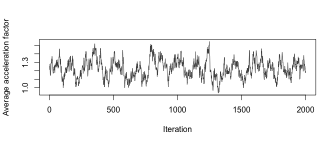

<!--
This vignette is precomputed.  Edit FusionForests.Rmd.orig and run
vignettes/precompile.R.  Never edit FusionForests.Rmd by hand.
-->


## Introduction

Randomised controlled trials (RCTs) estimate treatment effects without confounding.
They are often small, follow patients for a short period and enrol a selected population.
Observational studies (OS) are larger and broader.
Their treatment assignment may depend on unmeasured factors.
**FusionForests** combines the two sources.
It estimates heterogeneous treatment effects on survival without assuming that the observational data are unconfounded.

The package implements the model of Jacobs, van der Pas and van Wieringen (2026).
For a patient with covariates $x$, treatment $A$ and source $S$ (1 = RCT, 0 = OS), the log survival time follows an accelerated failure time model:
$$
\log T = m_0^{\mathrm{sh}}(x) + (1 - S)\, d(x) + A\, \tau(x) + (1 - S)\, A\, c(x) + \varepsilon .
$$
Each function receives its own Bayesian additive regression tree (BART) prior (Chipman et al., 2010).
The shared baseline $m_0^{\mathrm{sh}}$ describes survival without treatment.
The deviation $d$ allows the OS baseline to differ from the trial baseline.
The conditional average treatment effect (CATE) $\tau$ is common to both sources.
The confounding function $c$ absorbs the bias of the observational treatment contrast.
The error $\varepsilon$ follows a hierarchical Dirichlet process mixture with a scale per source.
The trial identifies $\tau$, and the observational study adds information on the baseline and the error distribution.

We illustrate the package on a semi-synthetic data set.
We describe the data, fit the model and summarise the posterior of the treatment effect, the confounding function and the error model.
The outcomes are simulated, so we can compare every estimate with the truth.

## Data

The data set `breast_fusion` combines an RCT of 686 patients with an OS of 2,982 patients.
The covariates are real.
They come from the GBSG2 trial (Schumacher et al., 1994) and the Rotterdam tumour bank (Royston and Altman, 2013), as distributed with the **survival** package.
The relapse-free survival times are simulated.
The trial treatment is randomised.
The OS treatment is the real, non-random treatment assignment of the Rotterdam cohort.
This assignment depends in part on year of surgery and chemotherapy, which `breast_fusion` omits.
The OS is subject to unmeasured confounding.
The companion data set `breast_fusion_truth` holds the true CATE and the omitted confounders.
The data describe no real treatment.


``` r
library(FusionForests)
library(survival)

x_names <- c("age", "meno", "size", "grade", "nodes", "pgr", "er")
head(breast_fusion)
#>   id source S A      time status age meno size grade nodes pgr er
#> 1  1    RCT 1 0 5.4318960      0  49    0    0     0     2   0  0
#> 2  2    RCT 1 0 1.4229003      1  55    1    0     1    16   0  0
#> 3  3    RCT 1 1 2.4312115      0  56    1    1     1     3   0  0
#> 4  4    RCT 1 1 0.2083447      1  45    0    1     1     1   0  4
#> 5  5    RCT 1 0 2.0120523      1  65    1    1     0     5   0 36
#> 6  6    RCT 1 1 0.7031060      1  48    0    2     0    11   0  0
table(source = breast_fusion$source, treated = breast_fusion$A)
#>       treated
#> source    0    1
#>    RCT  353  333
#>    OS  2643  339
```

The covariate distributions differ between the sources.
The trial enrolled node-positive patients only, whereas the OS also includes node-negative patients.


``` r
round(sapply(split(breast_fusion[, x_names], breast_fusion$source),
             colMeans), 2)
#>          RCT     OS
#> age    53.05  55.06
#> meno    0.58   0.56
#> size    0.81   0.64
#> grade   0.23   0.73
#> nodes   5.01   2.71
#> pgr   110.00 161.83
#> er     96.25 166.59
```

Figure 1 shows the Kaplan--Meier curves by source and arm.
The trial follows patients for a shorter period than the OS.


``` r
km   <- survfit(Surv(time, status) ~ source + A, data = breast_fusion)
cols <- rep(c("#E69F00", "#0072B2"), 2)
plot(km, col = cols, lty = c(1, 1, 2, 2), lwd = 2,
     xlab = "Years", ylab = "Relapse-free survival")
legend("topright", c("RCT control", "RCT treated", "OS control", "OS treated"),
       col = cols, lty = c(1, 1, 2, 2), lwd = 2, bty = "n")
```


## Model fit

`FusionForest()` takes covariate matrices, treatment and source indicators and the outcome.
We supply log survival times with their event indicators.
The test set determines where the posterior is evaluated.
We pass all patients as the test set, so that we can later summarise either source.
The argument `store_posterior_sample = TRUE` keeps the posterior draws that the summary functions need.
We run 2,000 burn-in and 2,000 posterior iterations, against a default of 5,000 each.


``` r
X      <- as.matrix(breast_fusion[, x_names])
A      <- breast_fusion$A
S      <- breast_fusion$S
y      <- log(breast_fusion$time)
status <- breast_fusion$status
is_rct <- S == 1
is_os  <- S == 0

set.seed(2026)
fit <- FusionForest(
  y = y, status = status,
  X_train_control = X, X_train_treat = X,
  treatment_indicator_train = A, source_indicator_train = S,
  X_test_control = X, X_test_treat = X,
  treatment_indicator_test = A, source_indicator_test = S,
  outcome_type = "right-censored", timescale = "log",
  N_post = 2000, N_burn = 2000,
  store_posterior_sample = TRUE, verbose = FALSE
)
fit
#> FusionForest fit
#>   Outcome type:    right-censored (timescale: log)
#>   Treatment coding: centered 
#>   Error model:     source_hdp_scale
#>   Observations:    3668 (RCT: 686, RWD: 2982)
#>   Covariates:      7 (control forest), 7 (treatment forest)
#>   Posterior draws: 2000 (burn-in: 2000)
```

The default settings follow the paper.
The error model is the hierarchical Dirichlet process mixture with source-specific scales (`error_dist = "source_hdp_scale"`).
The treatment indicator enters centred at one half (`treatment_coding = "centered"`), so that both arms inform $\tau$.
The summary reports the residual scale, the spread of the individual CATEs and the acceptance ratios of the tree updates.


``` r
summary(fit)
#> Summary of FusionForest fit
#> 
#> Model
#>   Outcome type:    right-censored
#>   Treatment coding: centered 
#>   Error model:     source_hdp_scale
#>   Observations:    3668 (RCT: 686, RWD: 2982)
#>   Posterior draws: 2000 (burn-in: 2000)
#> 
#> Residual standard deviation (posterior)
#>   Mean: 0.604   Median: 0.604   95% CI: [0.549, 0.658]
#> 
#> Estimated individual treatment effects on log time (posterior means)
#>    2.5%     25%     50%     75%   97.5% 
#> -0.0274  0.0638  0.1610  0.2770  0.4860 
#> 
#> Average Metropolis-Hastings acceptance ratios
#>   control     treat    deconf deviation 
#>     0.276     0.194     0.165     0.258
```

### Single-source comparators

We compare the fusion fit with two single-source analyses.
`CausalShrinkageForest()`, re-exported from **ShrinkageTrees**, fits a causal forest to one source.
We match its priors to those of `FusionForest()`.
The RCT-only fit is unconfounded but uses 686 patients.
The OS-only fit uses 2,982 patients but ignores the unmeasured confounding.
It estimates $\tau + c$ rather than $\tau$.


``` r
fit_single <- function(rows) {
  CausalShrinkageForest(
    y = y[rows], status = status[rows],
    X_train_control = X[rows, ], X_train_treat = X[rows, ],
    treatment_indicator_train = A[rows],
    X_test_control = X, X_test_treat = X, treatment_indicator_test = A,
    outcome_type = "right-censored", timescale = "log",
    number_of_trees_control = 200, number_of_trees_treat = 100,
    prior_type_control = "standard", prior_type_treat = "standard",
    local_hp_control = 1 / (2 * sqrt(200)),
    local_hp_treat = 0.5 / (2 * sqrt(100)),
    power_control = 2, power_treat = 3,
    N_post = 2000, N_burn = 2000,
    store_posterior_sample = TRUE, verbose = FALSE
  )
}
set.seed(2026)
fit_rct <- fit_single(is_rct)
fit_os  <- fit_single(is_os)
```

## Treatment effects

### Acceleration factor

The acceleration factor $\exp\{\tau(x)\}$ multiplies the survival time of a patient with covariates $x$ under treatment.
`fusion_estimand()` returns its posterior draws at each test point.
With `population_average = TRUE` it averages over the test points.
The default weights follow the Bayesian bootstrap (Rubin, 1981), which propagates uncertainty about the covariate distribution.
Our test set is the union of both sources.


``` r
af_union <- fusion_estimand(fit, "AF", population_average = TRUE, seed = 1)
quantile(af_union, c(0.025, 0.5, 0.975))
#>     2.5%      50%    97.5% 
#> 1.031035 1.226773 1.436635
mean(exp(breast_fusion_truth$tau))
#> [1] 1.223145
```

The second line gives the true average.
A trace of the equally weighted average is a simple check of mixing (Figure 2).


``` r
af_trace <- fusion_estimand(fit, "AF", population_average = TRUE,
                            bayesian_bootstrap = FALSE)
plot(af_trace, type = "l", col = "grey30",
     xlab = "Iteration", ylab = "Average acceleration factor")
```



We target a single source by averaging the pointwise draws over its patients.
We do so for the fusion fit and both comparators.


``` r
af_draws <- list(
  "RCT only"     = exp(fit_rct$test_predictions_sample_treat),
  "OS only"      = exp(fit_os$test_predictions_sample_treat),
  "FusionForest" = fusion_estimand(fit, "AF")
)
summarise_af <- function(rows) {
  t(sapply(af_draws, function(d) {
    v <- rowMeans(d[, rows])
    c(mean = mean(v), quantile(v, c(0.025, 0.975)))
  }))
}
af_tab  <- list(RCT = summarise_af(is_rct), OS = summarise_af(is_os))
af_true <- c(RCT = mean(exp(breast_fusion_truth$tau[is_rct])),
             OS  = mean(exp(breast_fusion_truth$tau[is_os])))
lapply(af_tab, round, 3)
#> $RCT
#>               mean  2.5% 97.5%
#> RCT only     1.321 1.154 1.506
#> OS only      1.557 1.305 1.855
#> FusionForest 1.271 1.076 1.473
#> 
#> $OS
#>               mean  2.5% 97.5%
#> RCT only     1.310 1.095 1.573
#> OS only      1.246 1.045 1.444
#> FusionForest 1.216 1.014 1.437
round(af_true, 3)
#>   RCT    OS 
#> 1.308 1.204
```


``` r
op <- par(mfrow = c(1, 2), mar = c(4, 7.5, 2, 1))
for (p in names(af_tab)) {
  tb <- af_tab[[p]]
  plot(tb[, "mean"], 1:3, xlim = range(tb, af_true), yaxt = "n", pch = 19,
       xlab = "Average acceleration factor", ylab = "",
       main = paste(p, "population"))
  segments(tb[, "2.5%"], 1:3, tb[, "97.5%"], 1:3, lwd = 2)
  axis(2, at = 1:3, labels = rownames(tb), las = 1)
  abline(v = af_true[p], lty = 2)
}
```


``` r
par(op)
```


Figure 3 compares the three analyses.
In the OS population, the fusion interval is 0.88 times as wide as the RCT-only interval.

### Survival difference

The survival difference $S_1(t \mid x) - S_0(t \mid x)$ compares the survival probabilities at time $t$ under treatment and control.
It depends on the baseline and the error distribution as well as on $\tau$.
`fusion_estimand()` evaluates it in closed form at a time `time`, measured on the original time scale.
The argument `target_source` selects the baseline and error distribution of the RCT or the OS.
We compute the difference in the trial population over the first seven years (Figure 4).


``` r
times  <- seq(0.5, 7, by = 0.5)
sd_rct <- sapply(times, function(t) {
  d <- fusion_estimand(fit, "SD", time = t, target_source = "rct")
  v <- rowMeans(d[, is_rct])
  c(mean = mean(v), quantile(v, c(0.025, 0.975)))
})
round(sd_rct[, times == 5], 3)
#>  mean  2.5% 97.5% 
#> 0.097 0.027 0.159
```


``` r
plot(times, sd_rct["mean", ], type = "n", ylim = range(0, sd_rct),
     xlab = "Years", ylab = "Survival difference")
polygon(c(times, rev(times)), c(sd_rct["2.5%", ], rev(sd_rct["97.5%", ])),
        col = "grey85", border = NA)
lines(times, sd_rct["mean", ], lwd = 2)
abline(h = 0, lty = 2)
```


### Heterogeneity

The posterior mean CATE differs between patients.
Figure 5 plots it against the true CATE.
Tree ensembles shrink extreme effects towards the average, which flattens the point cloud.


``` r
tau_hat <- fit$test_predictions_treat
plot(breast_fusion_truth$tau, tau_hat, pch = 16, cex = 0.4,
     col = ifelse(is_rct, "#0072B2", "#E69F00"),
     xlab = "True CATE (log time)", ylab = "Posterior mean CATE (log time)")
abline(0, 1, lty = 2)
legend("topleft", c("RCT", "OS"), col = c("#0072B2", "#E69F00"),
       pch = 16, bty = "n")
```


A linear summary of the CATE is easier to report than a nonparametric surface.
`fusion_projection()` projects every posterior draw of $\tau$ onto a linear basis (Woody et al., 2021).
The projection coefficients inherit a posterior distribution.
Bayesian-bootstrap weights add the uncertainty about the covariate distribution.
The basis columns are centred, so the intercept is the average CATE.
For reference, we project the true CATE onto the same basis.
In the simulation the CATE depends on the progesterone receptor and grade only.


``` r
basis <- ~ age + meno + size + grade + log1p(nodes) + log1p(pgr) + log1p(er)
proj  <- fusion_projection(fit, basis = basis, X_eval = as.data.frame(X),
                           weights = "bayesian_bootstrap", seed = 1)

truth_df  <- cbind(as.data.frame(X), tau = breast_fusion_truth$tau)
proj_true <- coef(lm(update(basis, tau ~ .), data = truth_df))
proj_true[1] <- mean(breast_fusion_truth$tau)

proj_tab <- t(apply(proj, 2, function(v)
  c(mean = mean(v), quantile(v, c(0.025, 0.975)))))
round(cbind(proj_tab, truth = proj_true), 3)
#>                mean   2.5% 97.5%  truth
#> (Intercept)   0.182  0.014 0.341  0.162
#> age          -0.002 -0.008 0.004  0.000
#> meno         -0.001 -0.182 0.186  0.000
#> size          0.027 -0.075 0.128  0.000
#> grade        -0.112 -0.286 0.076 -0.200
#> log1p(nodes) -0.001 -0.060 0.062  0.000
#> log1p(pgr)    0.045  0.008 0.082  0.115
#> log1p(er)     0.010 -0.025 0.046  0.000
```

## Confounding and baseline deviation

The forests for $c$ and $d$ describe how the OS differs from the trial.
A non-zero $c(x)$ signals that the observational treatment contrast is biased at $x$.
A non-zero $d(x)$ signals that the OS baseline differs from the trial baseline.
Figure 6 shows the posterior means for the OS patients.


``` r
c_hat <- fit$test_predictions_deconf[is_os]
d_hat <- fit$test_predictions_deviation[is_os]
op <- par(mfrow = c(1, 2), mar = c(4, 4, 2, 1))
hist(c_hat, breaks = 30, col = "grey80", border = "white",
     main = "Confounding function", xlab = "c(x) (log time)")
abline(v = 0, lty = 2)
hist(d_hat, breaks = 30, col = "grey80", border = "white",
     main = "Baseline deviation", xlab = "d(x) (log time)")
abline(v = 0, lty = 2)
```


``` r
par(op)
```


The average posterior mean of $c$ over the OS patients is 0.076.
For comparison, the OS-only and fusion estimates of the average CATE in the OS differ by -0.016.

## Error distribution

The default error model gives each source its own scale $\sigma_s$.
The fit stores their posterior draws in `fit$dp_sigma_g`, with the OS first and the RCT second.


``` r
sigma_s <- sapply(fit$dp_sigma_g, quantile, c(0.025, 0.5, 0.975))
colnames(sigma_s) <- c("OS", "RCT")
round(sigma_s, 3)
#>          OS   RCT
#> 2.5%  0.551 0.516
#> 50%   0.605 0.599
#> 97.5% 0.662 0.668
```

## Further options

`FusionForest()` supports several variations of the analysis above.

| Argument | Purpose |
|:---|:---|
| `outcome_type = "continuous"` | Uncensored continuous outcomes. |
| `observed_left_time`, `observed_right_time`, `interval_censoring_indicator` | Interval-censored event times. |
| `error_dist` | Gaussian, Dirichlet process and hierarchical Dirichlet process error models. |
| `treatment_coding`, `propensity_train`, `propensity_test` | Binary, centred or propensity-adjusted treatment coding. |
| `k_deviation = 0` | Full pooling of the two baselines ($d = 0$). |
| `number_of_trees_*`, `k_*`, `power_*`, `base_*` | Size and regularisation of each forest. |

The package re-exports the single-source models of **ShrinkageTrees**: `ShrinkageTrees()`, `HorseTrees()`, `CausalShrinkageForest()`, `CausalHorseForest()`, `SurvivalBART()`, `SurvivalDART()`, `SurvivalBCF()` and `SurvivalShrinkageBCF()`.

## References

Chipman, H. A., George, E. I. and McCulloch, R. E. (2010).
BART: Bayesian additive regression trees.
*The Annals of Applied Statistics*, 4, 266--298.

Jacobs, T., van der Pas, S. L. and van Wieringen, W. N. (2026).
Bayesian fusion forests for heterogeneous treatment effects on survival from randomised and real-world data.
Manuscript.

Royston, P. and Altman, D. G. (2013).
External validation of a Cox prognostic model: principles and methods.
*BMC Medical Research Methodology*, 13, 33.

Rubin, D. B. (1981).
The Bayesian bootstrap.
*The Annals of Statistics*, 9, 130--134.

Schumacher, M., Bastert, G., Bojar, H., et al. (1994).
Randomized 2 x 2 trial evaluating hormonal treatment and the duration of chemotherapy in node-positive breast cancer patients.
*Journal of Clinical Oncology*, 12, 2086--2093.

Woody, S., Carvalho, C. M. and Murray, J. S. (2021).
Model interpretation through lower-dimensional posterior summarization.
*Journal of Computational and Graphical Statistics*, 30, 144--161.
